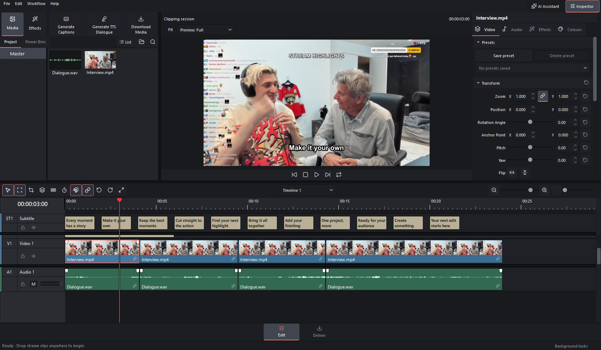
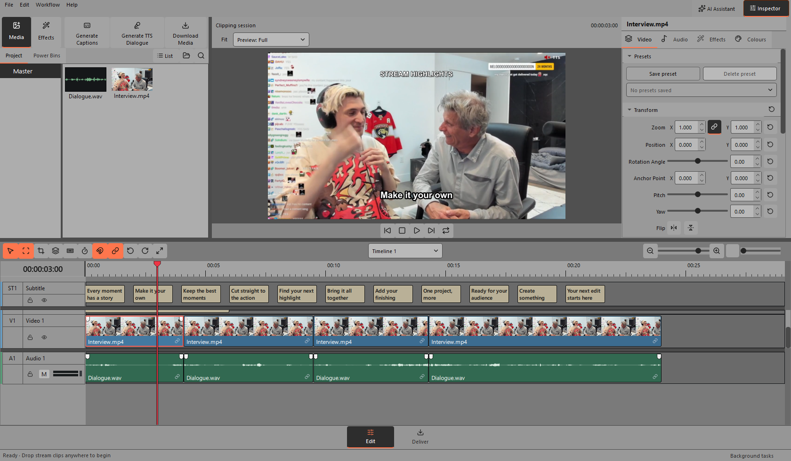
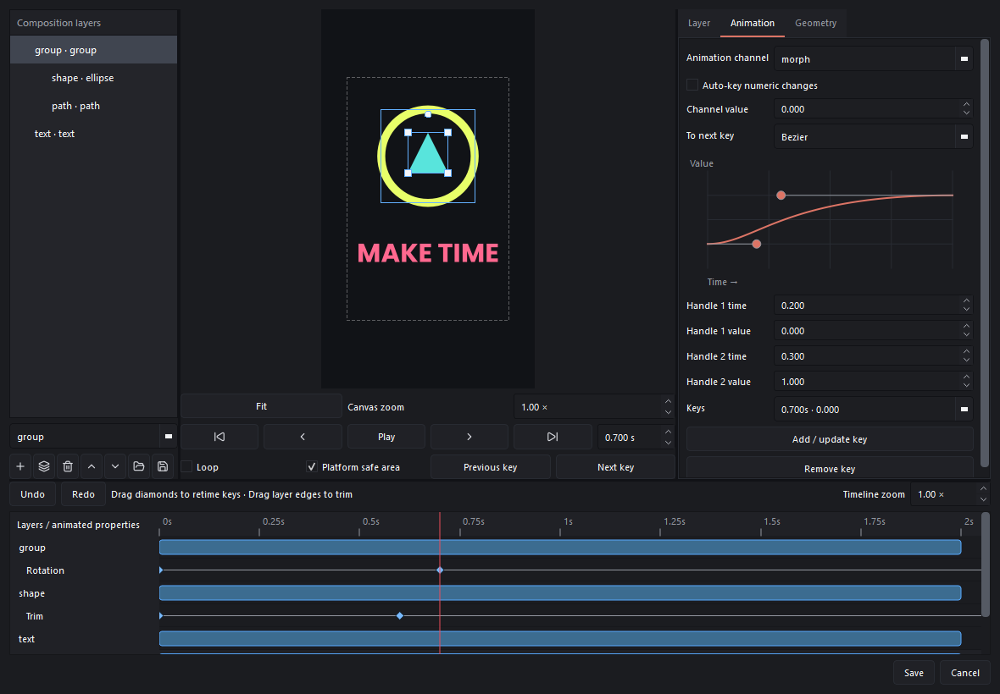

# Kinetic Cut

A lightweight Windows video editor inspired by DaVinci Resolve, built for fast
short-form editing and general video projects. Includes layered video/audio
timelines, transforms, effects, graphics, captions, Power Bins and export tools.
Projects and media stay local.

[Download the Windows installer](https://github.com/farhanr3001/video-editor/releases/latest).



*Default theme · a real editing project with captions, motion graphics and layered audio/video.*

Editable motion compositions add parented layers, animated typography, masks,
vector reveals and morphs, Bézier easing and motion blur with matching exports.
Typewriter text, animated counters, corner radii and soft shape shadows support
interface motion design. Project frame rates include 120 fps export.
Reusable product/price cards, animated totals, showcases and chapter titles
offer editable images, colours, prices and animation timing. The motion editor
includes a layer/keyframe timeline, canvas handles, multi-selection, marquee
selection, inline text editing and its own undo/redo and playback shortcuts.
Motion scale axes link by default and can be unlinked. Multi-selection inspector
steps and drags preserve individual values; typed values assign an exact value.
Selected video layers show their transform boxes together.
Timeline tools include re-time controls (Ctrl+R) and compact fade handles.
The preview and timeline use GPU-backed Qt surfaces on supported systems, with
D3D11 composition on Windows and bounded background compatibility work;
optional cache cleanup runs only after the editor finishes closing; Power Bin
previews remain available and reused between projects.
Local object tracking adds moving censors, arrows, outlines, labels, image
markers and following crops, with adjustable appearance and correction points.
The tracking workspace includes GPU playback, direct marker handles, a zoomable
frame timeline, linked table/diamond multi-selection and timed marker styles.
Advanced Colours adds grading wheels, presets, hold-to-compare source
colours and local undo/redo; Apply creates one editor undo step.
The Media/Effects workspace gives the timeline the full window width. The Effects
library includes search, favourites, recent items and effect-specific previews.

Projects can contain multiple named timelines with a shared media pool and
clipboard, independent editing history and separate render-queue snapshots.
Fullscreen Timeline Mode expands the layers beside a resizable preview, with
floating Media, Effects and Inspector panels and bottom editing controls.
Help includes application repair, version details and support reports. Interrupted
sessions offer recoverable project copies; recovery storage is included in the
cache manager. An optional downloadable offline English voice is available.
Audio playback follows output changes made in Windows Volume Mixer.

## Effects and performance

GPU preview composition keeps timeline navigation responsive during playback.
Supported exports use D3D11 composition and hardware encoding; unsupported stacks
retain exact compatibility processing. Diagnostics distinguish GPU composition
from hardware decoding.

The Effects library includes 34 creative video/image effects, linked speed presets
and 49 transitions. New groups include distortion and flow, light and lens,
texture and retro, pieces and particles, and geometric reveals. Puzzle Assemble
connects moving pieces of the incoming video. Effects and transitions retain
editable inspector controls, ordering, undo/redo and project persistence.
Caption generation includes local speech alignment and an elapsed timer.
Completed render jobs are saved with projects. Export controls reset when switching
projects. GPU exports stream captions and motion graphics with exact frame reuse,
and supported retimes and transitions retain their preview geometry and timing.
Cached enhancement and vision frames stream on demand; uncached complex nested
timelines and explicit CPU compatibility can still require lossless preparation.
Action and crash logs help investigate interrupted editing sessions.

## Themes

Choose **Default**, **Obsidian**, or **Ableton Grey** from **File → UI Themes**.

<details>
<summary><strong>Obsidian</strong> — deep graphite with blue accents</summary>


</details>

<details>
<summary><strong>Ableton Grey</strong> — matte studio grey with orange accents</summary>



</details>

## Motion graphics editor

Build editable compositions with layers, canvas controls, keyframe timing and Bézier easing.

<details>
<summary>See the motion graphics workspace</summary>



</details>

## Installation

Editing and offline English caption generation are included. Optional face/background tools and vocal separation can be installed during
setup or downloaded later inside the app.
Use **FullSetup** for a new installation. Installed copies download changed files
for updates; settings, Power Bins and optional downloads are preserved.
Versions 1.1.20–1.1.22 use full installer updates so skipped versions also receive the repaired native uninstaller.
Uninstall removes Power Bins, settings, optional downloads, caches and files in
the default Kinetic Cut download folder. Projects and media elsewhere stay intact.

Built with Python, PySide6 and FFmpeg. See [dependency notices](THIRD_PARTY_NOTICES.txt).

## Connect Claude to the editor

Open AI Assistant and choose **Connect to Claude Desktop**, then fully quit and
restart Claude Desktop. Keep Kinetic Cut open and enable its tools in your chat.
The setup preserves other MCP servers and backs up existing Claude configuration.
**Copy Claude Desktop JSON** provides the same local stdio configuration manually.

For Claude Code, choose **Copy Claude Code command**, paste it into PowerShell,
and check `/mcp` in Claude Code. No Node/Python install or API key is required for
the installed editor bridge. Connection status verifies actual requests, not just
configuration. Browser-only Claude cannot connect directly to this local bridge.

Setup follows the [MCP local-server guide](https://modelcontextprotocol.io/docs/develop/connect-local-servers)
and [Claude Code MCP documentation](https://code.claude.com/docs/en/mcp).

## Reliability and release checks (development)

Run `python scripts/check_project.py build/checkpoint` for the complete isolated
source suite. Each module gets a fresh profile, a deadline, fault traces and its
own log. Passing reports include the source fingerprint; zero-test modules fail.
Add actual test filenames after the output directory for an affected-scope run.
GitHub Actions runs source checks on pushes and pull requests, preserving reports.
Hosted source checks do not replace native Windows/GPU and installation checks.
Once the candidate has been built and safely installed, `python scripts/check_release.py build/release-check-<unique-name>`
runs all four milestones and seals the release evidence in one command. It never
replaces an open editor or publishes anything. Pass `--offline-fixture <verified-runtime-folder>`
to include real offline narration in the packaged checks.

`python scripts/reproduce.py --help` lists reusable native reproductions. They run
on a private desktop with disposable profiles. The speech-service case contacts
the free online service using fixed diagnostic text; offline narration is an
explicit optional download, never an implicit test dependency.

Use `python scripts/verify_package.py <exe> <output> --kind staged` and again with
`--kind installed` after safe local installation. These check packaged source,
managed files, startup, Help and recovery UI in all themes. Use
`python scripts/verify_installer.py build/installer-check-<unique-name>` after
generating installer sizes: it compiles a separate-identity/no-shortcuts test
installer, checks install/upgrade/owned-helper closure/startup/uninstall and keeps
the second-phase uninstall log. No installed ownership log is copied elsewhere.

Before release, build the current payloads and installers. For a one-time full
installer update, run `python scripts/release_gate.py prepare-installer-channel`
before sealing the evidence. Then run:

```
python scripts/release_gate.py seal build/release-gate.json --source <checkpoint/report.json> --staged <staged/report.json> --installed <installed/report.json> --installer <installer/report.json>
```

Release uploads require `scripts/publish_release.py --gate build/release-gate.json`.
The gate rejects stale source, incomplete milestones and changed release files.
`--preview` publishes an opt-in GitHub prerelease; Stable users stay on the normal
stable channel. Public publication still requires the owner's explicit instruction.
Never label an unexecuted hosted run, native workflow or installation as passed.
