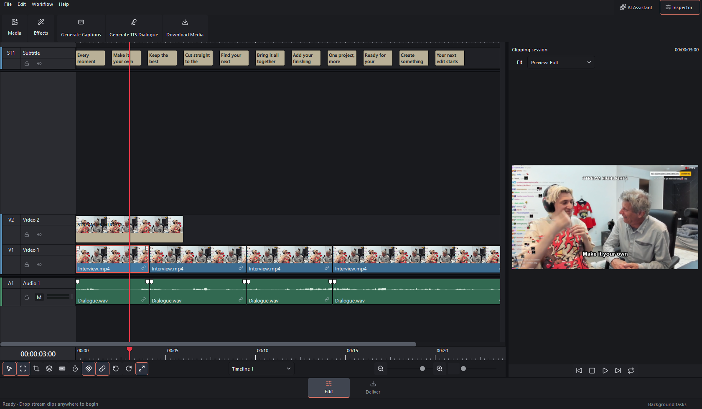
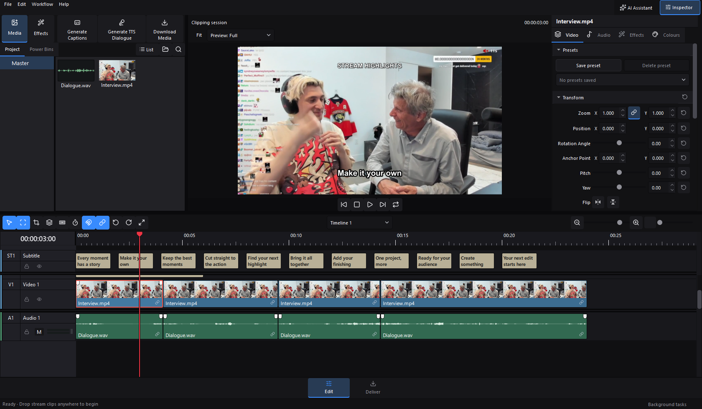

# Kinetic Cut

A Windows video editor for turning long recordings into finished clips. Cut and
arrange video, audio and captions, build vertical or landscape edits, and export
with GPU acceleration on supported hardware. Your projects and media stay local.

**[Download for Windows](https://github.com/farhanr3001/video-editor/releases/latest)**

## Made for editing

- **A flexible timeline.** Work with multiple video, audio and subtitle layers,
  linked clips, snapping, trimming and familiar keyboard shortcuts.
- **Multiple timelines, one project.** Keep separate edits together with a shared
  media pool and clipboard, plus independent undo/redo for each timeline.
- **Captions and dialogue.** Generate captions locally, adjust their timing and
  style, or create voice dialogue with online voices or an optional offline voice.
- **Creative tools.** Add titles, editable motion graphics and effects. Grade your
  footage with colour wheels, save presets and compare against the original.
- **Reusable media.** Keep favourite assets in Power Bins across projects.
- **Export your way.** Choose your resolution, aspect ratio and frame rate, then
  queue exports from any timeline. Hardware encoding is available where supported.

## More room for your timeline

Fullscreen Timeline Mode puts your layers beside a resizable preview. Media,
Effects and the Inspector open as temporary floating panels, keeping the workspace
available for editing. Switch back to the normal layout at any time.

## Choose your theme

Select **Default**, **Obsidian** or **Ableton Grey** from **File → UI Themes**.
The editor above uses Default; expand either option below for a closer look.

<strong>Obsidian</strong> — dark graphite with blue accents

<strong>Ableton Grey</strong> — studio grey with orange accents

## Get started

Download **FullSetup** from the [latest release](https://github.com/farhanr3001/video-editor/releases/latest)
for a new installation. Editing and offline English captions are included;
additional tools and voice downloads are optional.

Already installed? Use **File → Check for updates**. Updates preserve your settings,
Power Bins and optional downloads. **Help** includes recovery copies, application
repair, version details and support reports.

## Optional AI assistance

Kinetic Cut includes an MCP connection so compatible assistants can work with the
open editor. You can edit manually, use an assistant, or combine both.

For Claude Desktop, open **AI Assistant → Connect to Claude Desktop**, then fully
quit and restart Claude Desktop. For Claude Code, use **Copy Claude Code command**.
Keep Kinetic Cut open while connected. The installed bridge needs no separate
Python or Node installation.

<strong>For developers</strong>

Built with Python, PySide6, FFmpeg and a Windows GPU rendering engine.
See [third-party notices](THIRD_PARTY_NOTICES.txt).

Run `python scripts/check_project.py build/checkpoint` for isolated source checks.
Native GPU, packaged application and installer checks are separate; GitHub Actions
runs the source checks on pushes and pull requests.

