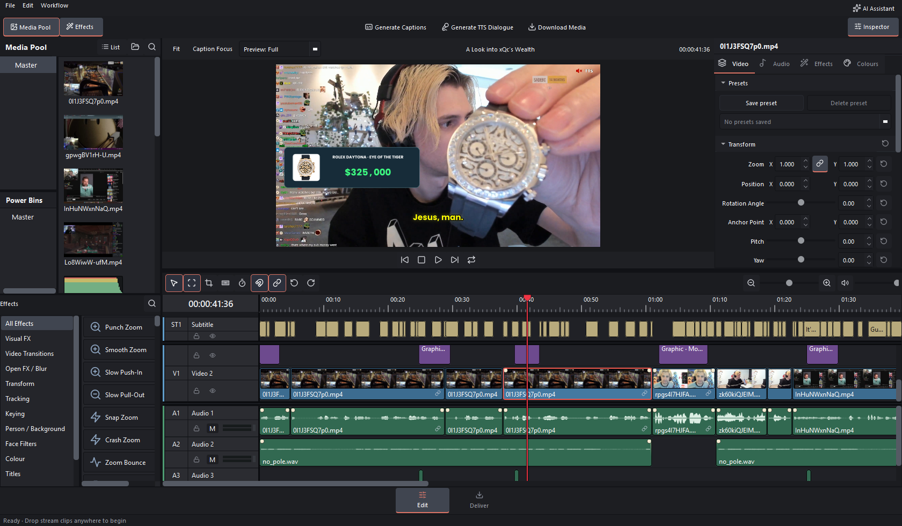
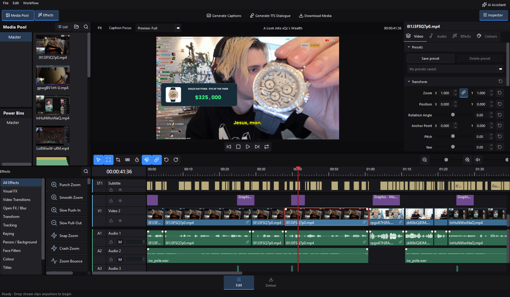
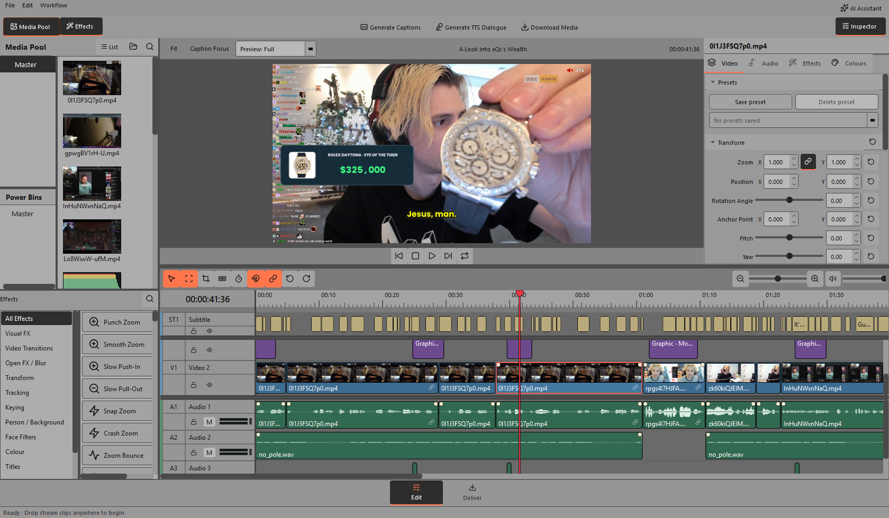
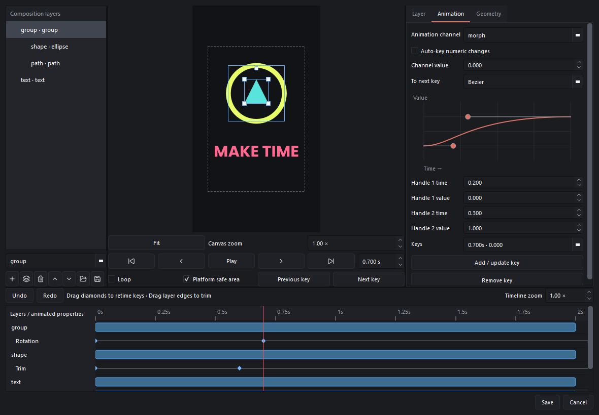

# Kinetic Cut

A lightweight Windows video editor inspired by DaVinci Resolve, built for fast
short-form editing and general video projects. Includes layered video/audio
timelines, transforms, effects, graphics, captions, Power Bins and export tools.
Projects and media stay local.

[Download the Windows installer](https://github.com/farhanr3001/video-editor/releases/latest).

*Default theme · a real editing project with captions, motion graphics and layered audio/video.*

Editable motion compositions add parented layers, animated typography, masks,
vector reveals and morphs, Bézier easing and motion blur with matching exports.
Typewriter text, animated counters, corner radii and soft shape shadows support
interface motion design. Project frame rates include 120 fps export.
Reusable product/price cards, animated totals, showcases and chapter titles
offer editable images, colours, prices and animation timing. The motion editor
includes a layer/keyframe timeline, canvas handles, multi-selection, marquee
selection, inline text editing and its own undo/redo and playback shortcuts.
Motion scale axes link by default and can be unlinked. Multi-selection inspector
steps and drags preserve individual values; typed values assign an exact value.
Selected video layers show their transform boxes together.
Timeline tools include re-time controls (Ctrl+R) and compact fade handles.
The preview and timeline use GPU-backed Qt surfaces on supported systems, with
D3D11 composition on Windows and bounded background compatibility work;
waveform cache files clear after the editor finishes closing.
Local object tracking adds moving censors, arrows, outlines, labels, image
markers and following crops, with adjustable appearance and correction points.

## Effects and performance

GPU preview composition keeps timeline navigation responsive during playback.
Supported exports use D3D11 composition and hardware encoding; unsupported stacks
retain exact compatibility processing. Diagnostics distinguish GPU composition
from hardware decoding.

The Effects library includes34 creative video/image effects, linked speed presets
and49 transitions. New groups include distortion and flow, light and lens,
texture and retro, pieces and particles, and geometric reveals. Puzzle Assemble
connects moving pieces of the incoming video. Effects and transitions retain
editable inspector controls, ordering, undo/redo and project persistence.
Caption generation includes local speech alignment and elapsed/estimated timing.
Completed render jobs are saved with projects.

## Themes

Choose **Default**, **Obsidian**, or **Ableton Grey** from **File → UI Themes**.

<strong>Obsidian</strong> — deep graphite with blue accents

<strong>Ableton Grey</strong> — matte studio grey with orange accents

## Motion graphics editor

Build editable compositions with layers, canvas controls, keyframe timing and Bézier easing.

See the motion graphics workspace

## Installation

Editing and offline English caption generation are included. Optional face/background tools and vocal separation can be installed during
setup or downloaded later inside the app.
Use **FullSetup** for a new installation. Installed copies download changed files
for updates; settings, Power Bins and optional downloads are preserved.
Versions 1.1.20–1.1.22 use full installer updates so skipped versions also receive the repaired native uninstaller.
Uninstall removes Power Bins, settings, optional downloads, caches and files in
the default Kinetic Cut download folder. Projects and media elsewhere stay intact.

Built with Python, PySide6 and FFmpeg. See [dependency notices](THIRD_PARTY_NOTICES.txt).
